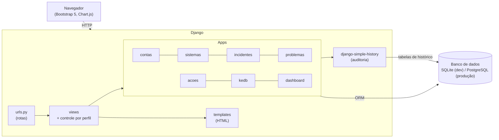

# Arquitetura

## Visão geral

O sistema é uma aplicação web monolítica em **Django**. O navegador faz requisições ao Django, que processa nas *views*, consulta o banco pelos *models* e devolve páginas HTML prontas, montadas com *templates* e Bootstrap. Não há um front-end separado (SPA) nem API: isso reduz a quantidade de tecnologias que o grupo precisa dominar em 14 dias.

O código é dividido em *apps* Django, um por módulo de negócio:

| App | Responsabilidade | Função |
|---|---|---|
| `contas` | Login, logout, usuário com perfil e controle de acesso | F1 |
| `sistemas` | Cadastro dos sistemas de TI | F2 |
| `incidentes` | Registro de incidentes e solução de contorno | F2 |
| `problemas` | Problemas, causa raiz e histórico de status | F1 / F2 |
| `acoes` | Ações corretivas | F2 |
| `kedb` | Base de erros conhecidos | F2 |
| `dashboard` | Indicadores para gestores | F3 (tela) / F1 (cálculos) |

## Diagrama

### Como ler

As setas mostram o caminho de uma requisição: o navegador chama uma URL; o Django encontra a *view* correspondente, que verifica o perfil do usuário, usa os *models* dos apps para ler ou gravar no banco e devolve um *template* HTML. Toda alteração em um modelo com histórico também gera um registro nas tabelas do simple-history (quem, o quê, quando).

### Como exportar a imagem

- **VS Code**: instale a extensão *Markdown Preview Mermaid Support* (ou *Mermaid Chart*), abra este arquivo e use a pré-visualização do Markdown (Ctrl+Shift+V). Clique com o botão direito no diagrama para copiar ou salvar.
- **mermaid.live**: copie o bloco de código para <https://mermaid.live> e use *Actions → PNG/SVG*.
- **Mermaid CLI**: `npx -p @mermaid-js/mermaid-cli mmdc -i docs/arquitetura.md -o docs/arquitetura.png` (gera uma imagem para cada diagrama do arquivo).

O GitHub também desenha diagramas Mermaid direto na visualização do arquivo.

## Decisões

| Decisão | Por quê |
|---|---|
| **Django com templates** (sem SPA) | Uma só linguagem (Python) e um só projeto. Login, admin, formulários, proteção CSRF e ORM já vêm prontos. Para um MVP em 14 dias, evita manter API + front-end separado. |
| **Bootstrap 5 via CDN** | Telas apresentáveis sem escrever muito CSS e sem etapa de build. HTMX (opcional) e Chart.js entram só nas telas que precisarem. |
| **django-simple-history** | A auditoria (quem, o quê, quando) é exigência de governança (rastreabilidade, COBIT DSS02/DSS03). A biblioteca grava o histórico com uma linha por modelo, sem código próprio. |
| **SQLite no desenvolvimento** | Não precisa instalar nada: cada pessoa clona e roda. |
| **PostgreSQL em produção** | Banco robusto, oferecido gratuitamente pelo Render. A troca é só a variável `DATABASE_URL` (dj-database-url), sem mudar código. |
| **Render (plano gratuito)** | Deploy direto do GitHub, HTTPS automático e PostgreSQL gerenciado, sem custo. Limitações: o serviço hiberna após 15 min sem acesso e o banco gratuito expira em 30 dias (ver README). |
| **Docker local (plano B)** | Se o Render falhar na apresentação, o sistema sobe na máquina com um comando, já com PostgreSQL. |
| **Configuração por variáveis de ambiente** (python-decouple) | Segredos ficam fora do repositório; o mesmo código roda em todos os ambientes. |
| **gunicorn + whitenoise** | Servidor de produção padrão do Python e arquivos estáticos servidos pelo próprio Django, sem servidor extra. |

O registro com datas está em [decisoes.md](decisoes.md).
