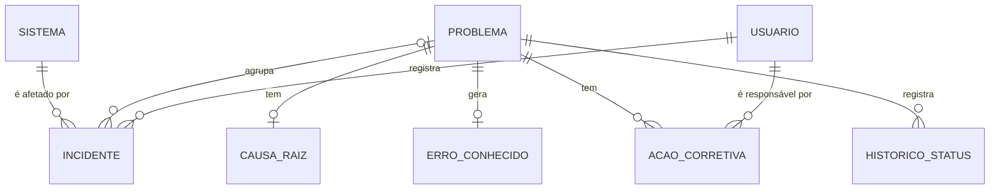

# Modelo de dados

> **Rascunho a validar.** A Função 2 (F2) vai propor o modelo completo, com atributos, até **23/10/2026**. Nada aqui foi implementado ainda, exceto o `Usuario` (app `contas`). Os nomes seguem [convencoes.md](convencoes.md).

## Entidades

| Entidade | Para que serve | Situação |
|---|---|---|
| Usuário | Pessoa que usa o sistema, com um dos 4 perfis | Implementado (`contas.Usuario`) |
| Sistema | Sistema ou serviço de TI afetado pelos incidentes | A definir (F2) |
| Incidente | Interrupção ou degradação de um serviço, tratada com solução de contorno | A definir (F2) |
| Problema | Causa raiz desconhecida de um ou mais incidentes | A definir (F1/F2) |
| CausaRaiz | Resultado da investigação (ex.: 5 Porquês) de um Problema | A definir (F2) |
| ErroConhecido | Registro na KEDB: causa conhecida e solução de contorno documentada | A definir (F2) |
| AçãoCorretiva | Ação para eliminar a causa raiz, com responsável, prazo e status | A definir (F2) |
| HistóricoStatus | Registro de cada mudança de status do Problema (quem, o quê, quando) | A definir (F1) |

## Relação central

**Um Problema se relaciona com vários Incidentes** (1 para N). O Incidente guarda a referência ao Problema (chave estrangeira opcional, pois nem todo incidente vira problema).

## Esboço das relações (a validar)

Somente a relação Problema → Incidentes é decisão do grupo. As demais cardinalidades são sugestões para a F2 confirmar ou corrigir.

## Auditoria

Os modelos de negócio devem usar `django-simple-history` (`history = HistoricalRecords()`), que grava automaticamente quem alterou, o que mudou e quando. O middleware já está configurado em `config/settings.py`.
