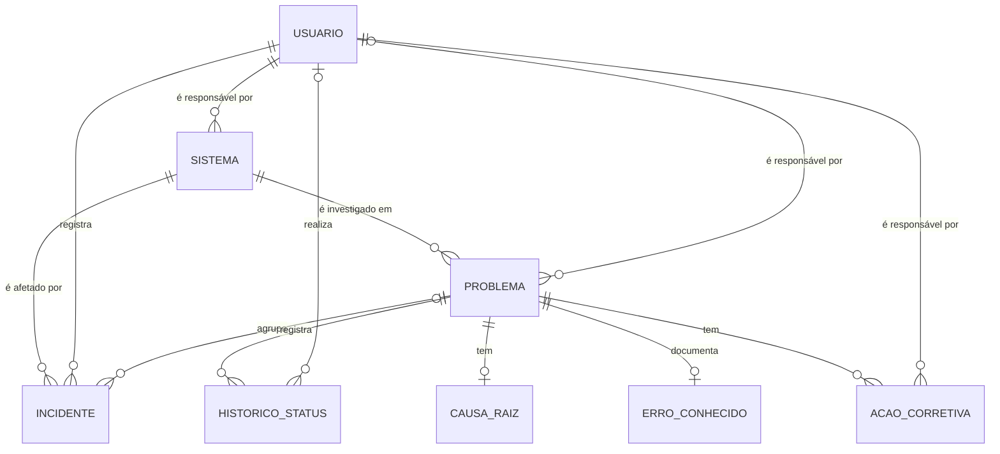

# Modelo de dados

Os nomes seguem [convencoes.md](convencoes.md). Este documento separa o que está implementado das propostas e decisões pendentes. RF04, RF05 e RF06 são os identificadores originais do planejamento acadêmico.

## Entidades

| Entidade | Para que serve | Situação |
|---|---|---|
| Usuário | Pessoa que usa o sistema, com um dos 4 perfis | Implementado (`contas.Usuario`) |
| Sistema | Sistema ou serviço de TI afetado pelos incidentes | Implementado (`sistemas.Sistema`, RF04) |
| Incidente | Interrupção ou degradação de um serviço | Cadastro, edição, consulta, auditoria, FK opcional para Problema e filtro por vínculo implementados |
| Problema | Causa raiz desconhecida de um ou mais incidentes | Implementado, com telas, validação da solução (RF13) e indicadores |
| CausaRaiz | Resultado da investigação (5 Porquês) de um Problema | Implementado (RF15), 1:1 com Problema |
| ErroConhecido | Registro na KEDB: causa conhecida e solução de contorno documentada | Implementado: cadastro/atualização (RF17) e pesquisa (RF18), 1:1 com Problema |
| AçãoCorretiva | Ação para eliminar a causa raiz, com responsável, prazo e status | Implementado (RF20/RF21) |
| HistóricoStatus | Registro de cada mudança de status do Problema (quem, o quê, quando) | Implementado para Problema, incluindo evento inicial |

## Sistema — implementado (RF04)

| Campo | Implementação | Validação |
|---|---|---|
| `id` | `BigAutoField`, chave primária automática | Gerado pelo banco |
| `nome` | `CharField(max_length=200)` | Obrigatório; o formulário remove espaços nas extremidades |
| `descricao` | `TextField` | Obrigatória; texto apenas com espaços é inválido no formulário |
| `responsavel` / `responsavel_id` | `ForeignKey(settings.AUTH_USER_MODEL, on_delete=PROTECT)` | Obrigatório; deve referenciar usuário com perfil `RESPONSAVEL_SISTEMA` |
| `history` | `HistoricalRecords()` | Histórico em tabela separada, gerada por django-simple-history |

O responsável é exibido como **Responsável pelo sistema**. Um Sistema possui um responsável; a implementação permite que um usuário seja responsável por vários sistemas. O acesso reverso é `usuario.sistemas_responsaveis.all()`.

**Seleção do responsável confirmada pela F2 em 08/11/2026:** exige o perfil `RESPONSAVEL_SISTEMA`. A FK usa `limit_choices_to`, aplicado na seleção e na validação de `SistemaForm` (aplicação e admin) e em `Sistema.full_clean()`. O superusuário pode operar o módulo, mas também precisa selecionar um responsável com o perfil exigido. Não há filtro adicional por atividade. Isso não concede ao responsável permissão para cadastrar, editar ou listar Sistemas.

A migration `0002_restringir_perfil_responsavel.py` atualiza os campos de Sistema e seu histórico, sem reatribuir responsáveis ou apagar registros. Se o perfil de um responsável mudar, uma próxima edição do Sistema exigirá a seleção de um usuário elegível. A gestão de perfis de `contas` permanece sob responsabilidade da F1. Scripts que gravem diretamente pelo ORM devem chamar `full_clean()` antes de salvar; `limit_choices_to` não é uma restrição SQL entre tabelas.

O limite de 200 caracteres, a ordenação por nome/ID e o nome do acesso reverso são escolhas técnicas desta implementação, não requisitos acadêmicos adicionais. Não há unicidade de nome nem novos status. `PROTECT` preserva a referência do responsável diante de uma tentativa de exclusão do usuário; não foi criado fluxo de exclusão de Sistemas.

### Operações e autorização

| Operação | Rota | Nome da URL | Perfil |
|---|---|---|---|
| Listagem | `/sistemas/` (GET) | `sistemas:listar` | Gestor de TI |
| Cadastro | `/sistemas/novo/` (GET/POST) | `sistemas:cadastrar` | Gestor de TI |
| Edição | `/sistemas/<int:pk>/editar/` (GET/POST) | `sistemas:editar` | Gestor de TI |

O decorator de `contas/permissoes.py` mantém o fluxo de login para anônimos, 403 para perfis não autorizados e a exceção existente para superusuário. Sistema inexistente na edição retorna 404; responsável inexistente enviado no formulário produz erro de validação. GET não grava; gravações usam POST com CSRF.

O admin usa `SimpleHistoryAdmin`, o mesmo formulário e a restrição de perfil. Além disso, mantém os requisitos próprios do admin Django: usuário ativo, `is_staff` e permissões de modelo (ou superusuário). A exclusão individual e em lote não é oferecida.

## Incidente — implementado (RF05/RF06), vínculo pelo backend de Problemas

O cadastro, a edição e a consulta de Incidentes estão funcionais. RF06 possui filtros por Sistema, período e presença/ausência de vínculo com Problema. O vínculo RF07 está implementado nos serviços e views de Problemas; sua tela fica com a F3.

### Campos implementados

| Campo | Implementação | Regra |
|---|---|---|
| `id` | `BigAutoField` | Chave primária automática |
| `titulo` | `CharField(max_length=200)` | Obrigatório |
| `descricao` | `TextField` | Obrigatória |
| `data_ocorrencia` | `DateTimeField` | Data e hora obrigatórias, seguindo `USE_TZ=True` e `America/Recife`; sem restrições adicionais para datas passadas ou futuras |
| `impacto` | `CharField(max_length=5, choices=ImpactoIncidente.choices)` | Obrigatório, sem valor padrão; códigos `BAIXO`, `MEDIO` e `ALTO` |
| `sistema` / `sistema_id` | FK para `sistemas.Sistema`, `on_delete=PROTECT` | Obrigatório; acesso reverso `sistema.incidentes` |
| `registrado_por` / `registrado_por_id` | FK para `settings.AUTH_USER_MODEL`, `on_delete=PROTECT`, `editable=False` | Atribuído pelo servidor a partir de `request.user`; não aparece no formulário e permanece imutável nas edições pela aplicação |
| `problema` / `problema_id` | FK opcional para `problemas.Problema`, `PROTECT`, `null=True`, `blank=True`, `editable=False` | No máximo um Problema; acesso reverso `problema.incidentes`; gravação pelo RF07 |
| `history` | `HistoricalRecords()` | Registra valores, data e autor de cada alteração |

O limite de 200 caracteres para título e `PROTECT` nas referências são escolhas técnicas, seguindo o padrão de Sistemas e preservando as associações. Não há fluxo de exclusão. Scripts futuros devem preservar `registrado_por`: `editable=False` protege os formulários, não torna a coluna imutável no banco.

As definições aprovadas pela F2 constam em [convencoes.md](convencoes.md):

- **Baixo:** efeito limitado, serviço principal disponível.
- **Médio:** degradação relevante ou indisponibilidade parcial.
- **Alto:** serviço essencial indisponível ou operação amplamente afetada.

### Operações e autorização

| Operação | Rota | Nome da URL | Acesso |
|---|---|---|---|
| Listagem | `/incidentes/` (GET) | `incidentes:listar` | Suporte, Desenvolvedor e Gestor de TI consultam todos; Responsável pelo sistema consulta somente os sistemas associados a ele |
| Cadastro | `/incidentes/novo/` (GET/POST) | `incidentes:cadastrar` | Suporte |
| Edição | `/incidentes/<int:pk>/editar/` (GET/POST) | `incidentes:editar` | Suporte edita somente seus próprios registros; Gestor de TI edita qualquer registro |

O superusuário conserva a exceção existente e pode cadastrar, consultar e editar qualquer Incidente. A autorização de edição não amplia o cadastro para Gestor de TI: RF05 continua reservado ao Suporte, além da exceção de superusuário.

A edição permite alterar título, descrição, ocorrência, impacto e sistema afetado; preserva o usuário que registrou. O vínculo com Problema pertence ao RF07 e não faz parte deste formulário. Se vinculado, o Incidente deve manter o mesmo Sistema do Problema; a validação de modelo impede trocar para outro Sistema. A edição POST bloqueia a linha dentro da transação para preservar o vínculo durante alterações concorrentes no PostgreSQL.

Anônimos seguem para login. Perfis sem permissão e Suporte tentando editar registro de outro autor recebem 403; IDs inexistentes na edição recebem 404 para perfis autorizados a essa operação. Formulários validam referências e choices no servidor, usam CSRF e exibem erros compreensíveis. O responsável recebe somente incidentes dos seus sistemas, inclusive ao enviar filtros manualmente.

Incidentes não está registrado no admin nesta etapa. O cadastro e a edição usam as views acima; o histórico pode ser consultado pelo ORM (`incidente.history.all()`). Isso mantém um único fluxo de atribuição do autor e autorização de edição.

### Filtros disponíveis (RF06)

- `sistema`: seleção opcional de Sistema existente. Para Responsável pelo sistema, as opções também se limitam aos seus sistemas.
- `data_inicio` (**De**) e `data_fim` (**Até**): datas opcionais no formato ISO (`AAAA-MM-DD`), incluindo integralmente os dias inicial e final em `America/Recife`, conforme confirmado pela F2.
- Um limite pode ser informado sem o outro. Filtros por Sistema e período podem ser combinados.
- Intervalo invertido, data inválida ou Sistema inválido exibem erro e não apresentam resultados. Essa validação é do filtro, não uma restrição à data de ocorrência cadastrada.
- `vinculo_problema`: vazio/Todos, `com`/Com vínculo ou `sem`/Sem vínculo. Combina com Sistema e período, preservando o escopo do usuário. Valor inválido produz erro e nenhum resultado.

### Relação central e migrations

**Um Problema se relaciona com vários Incidentes** (1 para N). A FK de cada Incidente é opcional; não há muitos-para-muitos, transferência ou desvinculação nesta etapa.

`problemas/0001_initial.py` depende de Sistemas e do usuário personalizado. Cria Problema, HistóricoStatus e suas tabelas de auditoria. `incidentes/0002_historicalincidente_problema_incidente_problema.py` depende de `problemas/0001_initial.py` e `incidentes/0001_initial.py`, adicionando a FK ao Incidente e ao seu histórico. Incidentes e snapshots anteriores ficam com vínculo nulo, sem inferir associações.

A inspeção de 08/11/2026 encontrou apenas placeholders de Problema nas referências locais. Por solicitação posterior da F2, o modelo foi implementado nesta entrega; não é necessário aguardar outro modelo da F1. A F3 continua com telas/navegação; a integração futura deve reutilizar este modelo e estas migrations.

## Problema — backend implementado

| Campo | Implementação | Regra |
|---|---|---|
| `id` | `BigAutoField` | Chave automática |
| `titulo` | `CharField(max_length=200)` | Obrigatório |
| `descricao` | `TextField` | Obrigatória |
| `status` | `CharField(max_length=20, choices=StatusProblema.choices, editable=False)` | Inicial `REGISTRADO`; alterado pelo serviço de transição |
| `prioridade` | `CharField(max_length=5, choices=PrioridadeProblema.choices, blank=True)` | Vazia na abertura; `BAIXA`, `MEDIA`, `ALTA` na atribuição |
| `sistema` | FK para Sistema, `PROTECT`, `editable=False` | Derivado dos Incidentes de abertura; acesso reverso `sistema.problemas` |
| `responsavel` | FK para usuário, `PROTECT`, `null=True`, `blank=True` | Não atribuído na abertura; deve ser Desenvolvedor; reverso `usuario.problemas_responsaveis` |
| `validado_por` | FK para usuário, `PROTECT`, `null=True`, `editable=False` (migração `0003_validacao_solucao`) | RF13: preenchido quando o Responsável pelo sistema valida a solução de um Problema Resolvido; exigido pelo Gestor de TI para encerrar; limpo na rejeição, que devolve o Problema para Em investigação |
| `history` | `HistoricalRecords()` | Snapshots de valores, data e autor |

Suporte abre um Problema a partir de pelo menos um Incidente sem vínculo, todos do mesmo Sistema, e pode vincular outros. A operação é transacional: uma seleção inválida ou falha de persistência não deixa Problema, vínculo ou histórico parcialmente gravado. Repetir o vínculo com o mesmo Problema não duplica ocorrências.

Gestor de TI atribui responsável e prioridade juntos. Responsável pelo Problema não é o mesmo papel de Responsável pelo sistema. O critério de elegibilidade é o perfil Desenvolvedor; não há filtro adicional por atividade na seleção.

Desenvolvedor e Gestor avançam sequencialmente: Registrado → Em investigação → Erro conhecido → Em correção → Resolvido → Encerrado. Saltos, repetição de status e reabertura são recusados. A última transição é reservada ao Gestor, com a exceção de superusuário, e exige pelo menos uma AçãoCorretiva e todas Concluídas. Nenhuma nova ação ou alteração de status de ação é aceita após o encerramento, inclusive pelo superusuário. Não há edição genérica ou exclusão.

Não foi definida restrição de transição apenas ao Desenvolvedor atribuído nem atribuição obrigatória antes de avançar. Essas restrições não foram introduzidas.

Suporte, Desenvolvedor e Gestor consultam todos; Responsável pelo sistema consulta somente Problemas dos seus sistemas. O queryset autorizado anota `quantidade_incidentes`. O detalhe inclui incidentes, eventos de status e snapshots de Problema. Fora do escopo do responsável, retorna 404. Superusuário conserva a exceção de perfil.

Formulários, views, URLs e templates estão implementados e publicados em `config/urls.py`. As operações e o contrato de contextos estão em [integracao-problemas-f3.md](integracao-problemas-f3.md). Problemas não está registrado no admin, evitando um caminho alternativo de escrita sem as regras dos serviços.

## HistóricoStatus — implementado para Problemas

| Campo | Implementação | Regra |
|---|---|---|
| `id` | `BigAutoField` | Chave automática |
| `problema` | FK para Problema, `PROTECT` | Reverso `problema.historico_status` |
| `status_anterior` | `CharField(max_length=20, choices=StatusProblema.choices, blank=True)` | Vazio somente no evento inicial |
| `status_novo` | `CharField(max_length=20, choices=StatusProblema.choices)` | Novo status |
| `data_alteracao` | `DateTimeField` | Mesma data do snapshot de Problema |
| `usuario` | FK para usuário, `PROTECT`, `null=True`, `blank=True` | Mesmo autor da auditoria; serviços sempre informam usuário autenticado |
| `history` | `HistoricalRecords()` | Auditoria do próprio registro |

O sinal `post_create_historical_record` de Problema cria o evento inicial e um evento por mudança de status. Alterações de responsável/prioridade não duplicam eventos de status, mas geram snapshots de Problema. Não há formulário de escrita de HistóricoStatus.

`usuario` admite nulo para representar honestamente uma gravação técnica via ORM sem autor, conforme o padrão da auditoria existente. Os serviços não usam esse caso: sempre definem `_history_user`. Scripts de negócio devem chamar os serviços para preservar autorização, transições e transações; `QuerySet.update` e operações em lote não disparam o histórico. O histórico das Ações Corretivas é mantido por `AcaoCorretiva.history`, conforme a seção 6.2 do planejamento; não se cria outro HistóricoStatus nem se reutiliza indevidamente a FK de Problema.

## Relações implementadas

## CausaRaiz — implementado (RF15)

| Campo | Implementação | Regra |
|---|---|---|
| `id` | `BigAutoField` | Automático |
| `descricao` | `TextField` | Obrigatória |
| `analise_5_porques` | `TextField` | Obrigatória; análise textual, sem impor cinco campos ou formato de diagrama |
| `problema` | `OneToOneField(Problema, PROTECT, editable=False)` | No máximo uma CausaRaiz por Problema; reverso `problema.causa_raiz` |
| `history` | `HistoricalRecords()` | Autor, data e valores em cada cadastro/atualização |

Qualquer Desenvolvedor cadastra ou atualiza o registro, com exceção de superusuário. O serviço `registrar_causa_raiz` bloqueia o Problema, valida e grava na mesma transação da auditoria. A unicidade também é garantida no banco. Atualizar não cria outro registro nem altera automaticamente o status de Problema.

Migration: `problemas/0002_causaraiz_historicalcausaraiz.py`, dependente da migration inicial de Problemas e do usuário personalizado.

## ErroConhecido — implementado (RF17, MVP)

| Campo | Implementação | Regra |
|---|---|---|
| `id` | `BigAutoField` | Automático |
| `sintoma` | `TextField` | Obrigatório |
| `causa` | `TextField` | Obrigatória |
| `solucao_contorno` | `TextField` | Obrigatória |
| `problema` | `OneToOneField(Problema, PROTECT, editable=False)` | No máximo um ErroConhecido por Problema; reverso `problema.erro_conhecido` |
| `history` | `HistoricalRecords()` | Autor, data e valores em cada cadastro/atualização |

Qualquer Desenvolvedor cadastra ou atualiza o registro, com exceção de superusuário. Os três campos são independentes: não se copia ou sincroniza automaticamente o texto de CausaRaiz. O serviço `kedb.services.registrar_erro_conhecido` mantém vínculo, unicidade e auditoria dentro da transação. Não muda o status de Problema.

A criação do ErroConhecido é **MVP (RF17)**; a pesquisa/consulta global da KEDB é **versão final (RF18)**. A consulta contextual no detalhe autorizado do Problema já está disponível no backend. Não há endpoint global de busca.

Migration: `kedb/0001_initial.py`, dependente de `problemas/0002_causaraiz_historicalcausaraiz.py` e do usuário personalizado.

## AçãoCorretiva — implementado (RF20/RF21)

| Campo | Implementação | Regra |
|---|---|---|
| `id` | `BigAutoField` | Automático |
| `descricao` | `TextField` | Obrigatória |
| `prazo` | `DateField` | Obrigatório; data sem horário, sem restrições adicionais a datas passadas/futuras |
| `status` | `CharField(max_length=20, choices=StatusAcaoCorretiva.choices, editable=False)` | Inicial `ABERTA` |
| `problema` | FK para Problema, `PROTECT`, `editable=False` | Obrigatório; reverso `problema.acoes_corretivas` |
| `responsavel` | FK para usuário, `PROTECT`, `limit_choices_to` Desenvolvedor | Obrigatório; reverso `usuario.acoes_corretivas_responsaveis` |
| `history` | `HistoricalRecords()` | Auditoria de criação e transições, conforme RF23/seção 6.2 |

Desenvolvedor e Gestor criam a ação. Qualquer Desenvolvedor avança seu status por `ABERTA → EM_ANDAMENTO → CONCLUIDA`, inclusive quando não é o responsável atribuído. Não há saltos, repetição, retorno, edição dos demais campos, transferência ou exclusão. O superusuário tem a exceção de perfil, sem dispensar regras de negócio.

Os serviços `criar_acao` e `alterar_status_acao` primeiro bloqueiam o Problema. O encerramento de Problema usa o mesmo bloqueio e só prossegue se há pelo menos uma ação e nenhuma pendente. Assim, no PostgreSQL, criação/transição de ações e encerramento são serializados pelo mesmo registro pai. SQLite usa os próprios bloqueios transacionais. As validações são repetidas dentro da transação, após validar os formulários.

Após Encerrado, o serviço impede criar ações ou alterar seus status. Atualizar CausaRaiz/ErroConhecido continua permitido e auditado, sem reabrir o Problema; não foi aprovada restrição adicional sobre essa documentação técnica.

Migration: `acoes/0001_initial.py`, dependente de `problemas/0002_causaraiz_historicalcausaraiz.py` e do usuário personalizado. Novas migrations criam tabelas; não inventam causa, erro ou ação para registros existentes.

## Consulta integrada e limites

O detalhe autorizado de Problema expõe causa, erro, ações e os snapshots de histórico das quatro entidades. `linha_do_tempo` reúne esses snapshots em ordem cronológica, com entidade, data, autor e registro. `historico_status` continua expondo os eventos de status de Problema. O escopo do Responsável pelo sistema é aplicado antes de carregar qualquer dado relacionado.

As views usam autenticação, autorização por perfil, validações de formulário e de serviço, CSRF e gravação por POST. IDs inexistentes retornam 404. As rotas de Problemas, Ações Corretivas e ErroConhecido aguardam os templates da F3; ver [integracao-problemas-f3.md](integracao-problemas-f3.md). Não há admin de escrita para esses módulos.

Pesquisa global da KEDB, alerta de recorrência, dashboard e validação do Responsável pelo sistema no encerramento pertencem à versão final e não foram implementados. O encerramento do MVP já funciona sob as condições aprovadas.

## Auditoria e governança

`Sistema` usa `history = HistoricalRecords()`. A migration `sistemas/0001_initial.py` cria `Sistema` e `HistoricalSistema`, com dependência do usuário personalizado. Cada cadastro/edição pelas views registra uma cópia dos valores, a data, o tipo da operação e o usuário autenticado, capturado pelo `HistoryRequestMiddleware` já configurado. O admin permite consultar esse histórico.

O responsável pelo Sistema e o autor da alteração são informações diferentes: o primeiro define responsabilidade sobre o sistema; o segundo identifica quem realizou cada mudança. Os testes verificam ambos, inclusive a troca de responsável por outro gestor.

`Incidente` também usa `HistoricalRecords()`. A migration `incidentes/0001_initial.py` cria o modelo e `HistoricalIncidente`, dependendo de Sistemas e do usuário personalizado. Cadastro e edição ocorrem em transação junto ao histórico. `registrado_por` identifica o autor original; `history_user` identifica cada editor, inclusive o Gestor de TI quando altera o registro de outra pessoa.

Gravações fora de uma requisição não recebem autor automaticamente; scripts futuros precisarão atribuir `_history_user` explicitamente. Operações em lote que não disparam o histórico não são usadas neste módulo.

A associação Sistema–Responsável explicita responsabilidades; as verificações de perfil limitam quem pode alterar o cadastro; o histórico sustenta auditoria e rastreabilidade. São evidências práticas para o trabalho de ITIL 4/COBIT 2019, sem substituir a matriz RACI ou o detalhamento de governança da F5.
